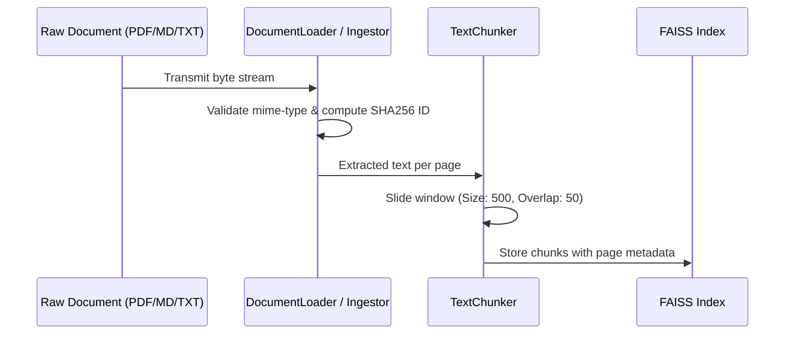
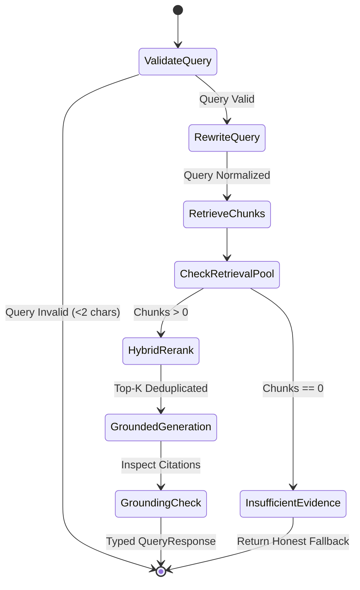

# Architecture & System Design Specification
## ShadowFox AI Engineering Portfolio: Beginner, Intermediate & Advanced

---

## 1. Executive Architectural Overview

This monorepo documents the progression from pure **Prompt-Based LLM Workflows** (Beginner) to **Retrieval-Augmented Generation** (Intermediate), and ultimately to **Production-Grade Agentic Orchestration with FastAPI, FAISS, and LangGraph** (Advanced).

```mermaid
graph TD
    subgraph Level 1: Beginner
        A1[User Text Input] --> B1[StudyService Domain Validation]
        B1 --> C1[Structured Prompts]
        C1 --> D1[Gemini 1.5 Flash API]
        D1 --> E1[Educational Output / Quizzes]
    end

    subgraph Level 2: Intermediate
        A2[Document Upload: PDF/TXT] --> B2[Text Extraction & Sliding Window Chunking]
        B2 --> C2[Dense Embeddings: text-embedding-004]
        C2 --> D2[FAISS IndexFlatIP Cosine Index]
        E2[User Query] --> F2[Embed Query & Top-K Retrieval]
        D2 --> F2
        F2 --> G2[Grounded Generation & Page Citations]
    end

    subgraph Level 3: Advanced
        A3[Multi-Format Ingestion: PDF/TXT/MD] --> B3[SHA256 Content Hashing & Chunking]
        B3 --> C3[DocumentScopedFAISSIndex]
        D3[REST API: POST /query] --> E3[FastAPI & Pydantic Validation]
        E3 --> F3[LangGraph StateGraph Engine]
        F3 --> G3[Validate ➔ Rewrite ➔ Retrieve ➔ Hybrid Rerank ➔ Grounding Check]
        G3 --> H3[Typed QueryResponse with Citations & Diagnostics]
    end
```

---

## 2. Prompt-Based Generation vs. Retrieval-Augmented Generation (RAG)

| Dimension | Prompt-Based Generation (Level 1) | Retrieval-Augmented Generation (Levels 2 & 3) |
| :--- | :--- | :--- |
| **Information Source** | Model's internal weights (parametric memory). | Dynamic external knowledge repository (non-parametric memory). |
| **Knowledge Freshness** | Capped at training cutoff. | Real-time, instant updates upon document ingestion. |
| **Hallucination Risk** | High for obscure, proprietary, or specific domain facts. | Low; constrained strictly to retrieved evidence context. |
| **Auditability & Trust**| Low; cannot verify internal reasoning steps. | High; verifiable inline page citations and verbatim excerpts. |
| **Use Cases** | Creative summarization, formatting, code generation, rewrites. | Technical document search, enterprise Q&A, legal/compliance research. |

---

## 3. Core Architectural Subsystems

### A. Document Ingestion & Chunking
- **Preprocessing:** Strips non-printable control characters, normalizes line breaks, and extracts selectable text.
- **Recursive Sliding Window:** Splits long documents into fixed-character windows (`chunk_size`) with controlled overlap (`chunk_overlap`).
- **Why Chunk Overlap Matters:** If a critical sentence or entity definition straddles the boundary between chunk $N$ and chunk $N+1$, zero overlap would truncate semantic context. A 10–20% overlap guarantees boundary continuity.
- **Metadata Tagging:** Every chunk carries its parent `document_id`, `document_name`, `page_number`, and `chunk_id`.

### B. Vector Embeddings & Similarity Search
- **Embeddings:** High-dimensional dense vectors (768 dimensions for Gemini `text-embedding-004`; 384 dimensions for deterministic local testing).
- **Mathematical Space:** Text strings with similar semantic meaning are mapped to proximal coordinates in Euclidean vector space.
- **FAISS (`IndexFlatIP`):** We perform L2 normalization on all vectors:
  $$\hat{\mathbf{v}} = \frac{\mathbf{v}}{\|\mathbf{v}\|_2}$$
  Because $\|\hat{\mathbf{a}}\|_2 = 1$ and $\|\hat{\mathbf{b}}\|_2 = 1$, their Inner Product ($IP$) equals exact Cosine Similarity:
  $$\hat{\mathbf{a}} \cdot \hat{\mathbf{b}} = \cos(\theta)$$
- **Why FAISS:** Sub-millisecond similarity lookups over thousands of vectors without database overhead.

### C. Hybrid Lexical-Semantic Reranking
Dense embeddings excel at conceptual meaning but occasionally miss rare technical codes, acronyms, or exact model numbers. KnowledgeForge AI introduces a **Hybrid Reranker**:
$$\text{Score}_{\text{composite}} = \alpha \cdot \text{Score}_{\text{semantic}} + \beta \cdot \text{Score}_{\text{lexical}} + \text{Bonus}_{\text{phrase}}$$
Where:
- $\alpha = 0.65$ (Cosine Vector Similarity)
- $\beta = 0.35$ (Query Keyword Overlap Coverage)
- Passages with $>85\%$ Jaccard token overlap are pruned, preventing redundant evidence from filling the context window.

### D. LangGraph State Machine
Production AI workflows require explicit, deterministically traceable state transitions rather than opaque black-box agents. KnowledgeForge AI implements an explicit LangGraph `StateGraph`:

### E. Document-Scoped Filtering
In enterprise applications, users must be able to query specific documents or isolated collections (e.g. "Only search within the 2026 Policy Manual").
`DocumentScopedFAISSIndex` enforces document-level security and filtering:
1. Candidate vectors are retrieved from FAISS.
2. If `document_ids` is specified, chunks outside the allowed list are discarded prior to reranking and prompt compilation.
3. Completely prevents cross-tenant document contamination.

---

## 4. Security & Production Engineering Standards
1. **Zero Secret Leakage:** No API keys are committed to source files. The codebase binds strictly to environment variables (`.env`).
2. **Defensive Prompting:** Retrieved document passages are delimited within explicit quotation blocks and treated as untrusted data, mitigating prompt injection.
3. **Loop Boundedness:** All LangGraph graphs enforce explicit terminal conditions and edge bounds, preventing infinite loop states.
4. **Reproducible Infrastructure:** Isolated Docker Compose environment ensures seamless cross-platform execution on Linux, macOS, and Windows.
